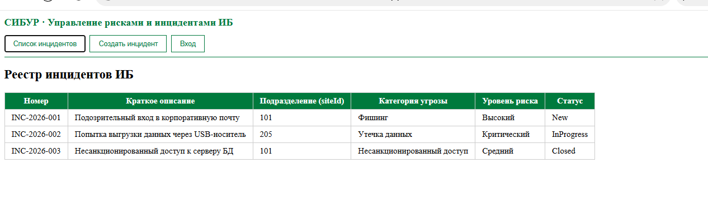
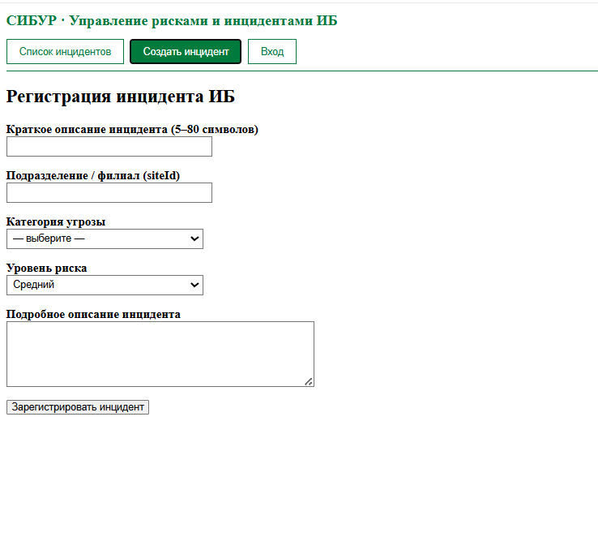
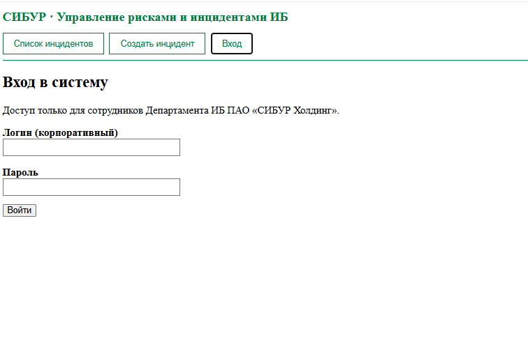

# ЛР3 — Каркас Vue и три экрана

## Скриншоты
### Список инцидентов

### Создание инцидента

### Вход

## Проверка

- `npm run dev` открывает приложение на http://localhost:5173
- Одновременно показан только один экран
- В списке 3 тестовые строки
- Статусы: New, InProgress, Closed

## Git
- Коммит «ЛР3: каркас Vue и три экрана»
- `node_modules` в `.gitignore`, не в Git