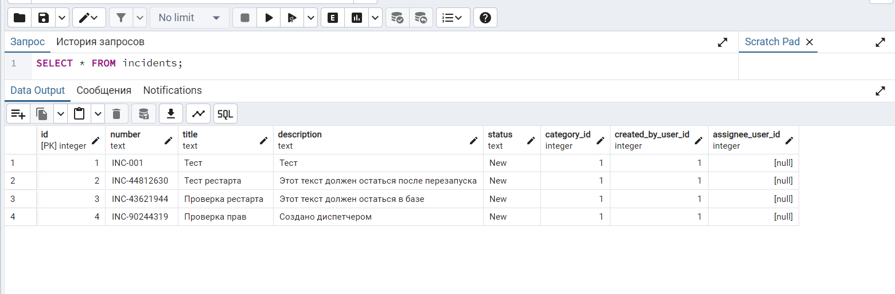
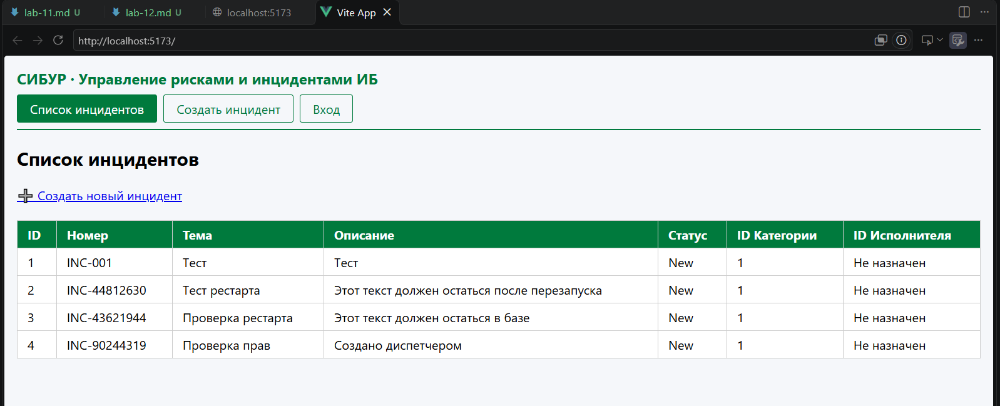

# Отчет по ЛР12. Сквозная сборка

## 1. Цель
Собрать три узла (Vue, ASP.NET Core, PostgreSQL) в единый стенд. Доказать, что один и тот же инцидент виден на экране, в Network-запросе и в базе данных.

## 2. Сквозной сценарий и доказательства

### Шаг 1. Просмотр списка и Network
Сайт Vue подключен к API. Запрос `GET /api/incidents` возвращает код 200 и данные из базы.

### Шаг 2. Проверка в SQL
В pgAdmin выполнен запрос `SELECT * FROM incidents;`, который подтверждает наличие записей в базе данных (id 1, 2, 3, 4).

### Шаг 3. Рестарт сервера
Сервер (API) был перезапущен (Ctrl+C и dotnet run), страница сайта обновлена. Все данные сохранились и отображаются в таблице.

## 3. Известные ограничения
Подробный список дефектов описан в `known-defects.md`. На данный момент управление статусами и назначение исполнителей выполняется через Swagger, а не через кнопки на сайте.