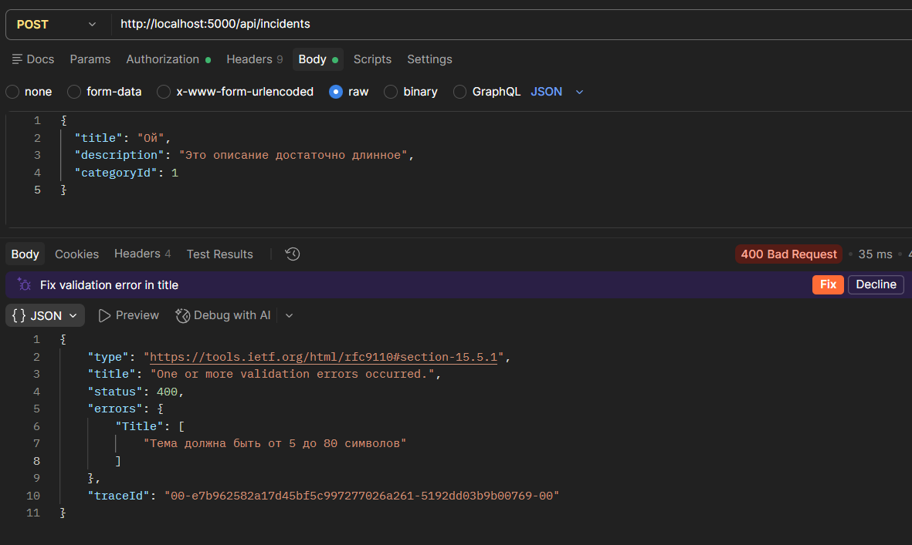
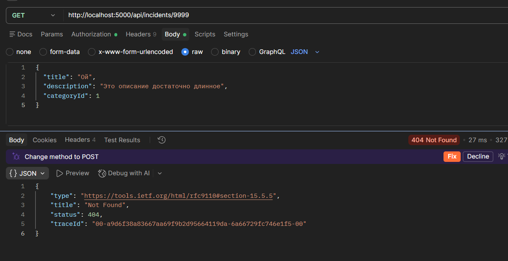
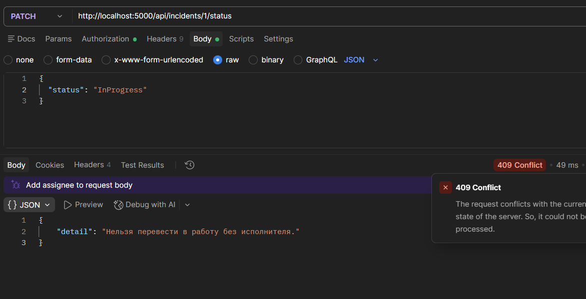

# Отчет по ЛР8. REST: заявки и проверка полей

## 1. Цель
Реализовать REST API для создания, чтения, назначения исполнителя и смены статуса инцидента. Проверить коды ответов 201, 400, 404, 409.

## 2. Что сделала
1. Создали `IncidentsController` и `IncidentService`.
2. Настроили валидацию входных данных (длина title от 5 до 80 символов).
3. Разделили логику на два PATCH-запроса (назначение и статус).
4. Исключили удаление записей (DELETE), отмена происходит через статус Cancelled.

## 3. Доказательство успеха (201 Created)
Успешное создание инцидента через POST-запрос
              
 
## 4. Доказательство отказов (400, 404, 409)
### Ошибка 400 (Bad Request)
Сервер вернул ошибку при попытке отправить слишком короткий заголовок (менее 5 символов).

### Ошибка 404 (Not Found)
Сервер вернул ошибку при запросе несуществующего ID.

### Ошибка 409 (Conflict)
Сервер запретил перевод инцидента в статус InProgress без назначенного исполнителя.

