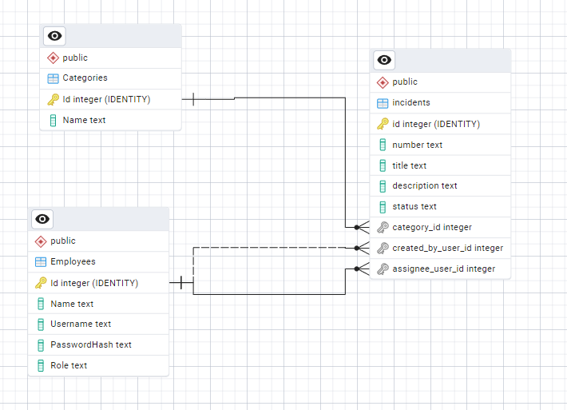

# Отчет по ЛР9. PostgreSQL и SQL

## 1. Цель
Создать SQL-схему базы данных, наполнить её данными, выполнить запросы (фильтрация, JOIN, GROUP BY) и проверить ограничения CHECK.

## 2. Схема и данные
Скрипт создания таблиц и связей находится в `db/schema.sql`. Схема включает таблицы `incidents`, `categories`, `employees`.
Скриншот структуры таблиц в pgAdmin:

## 3. Запросы (queries.sql)
Были выполнены обязательные запросы.
- **Фильтрация и сортировка:** выборка только новых инцидентов (`WHERE status = 'New'`).

- **JOIN:** соединение инцидентов с таблицей категорий для вывода названия категории.

- **GROUP BY:** подсчет количества инцидентов в каждом статусе.

## 4. Проверка ограничения CHECK
При попытке обновить статус инцидента на недопустимое значение 'Done' база данных выдала ошибку, так как сработало ограничение `incidents_status_check`.
